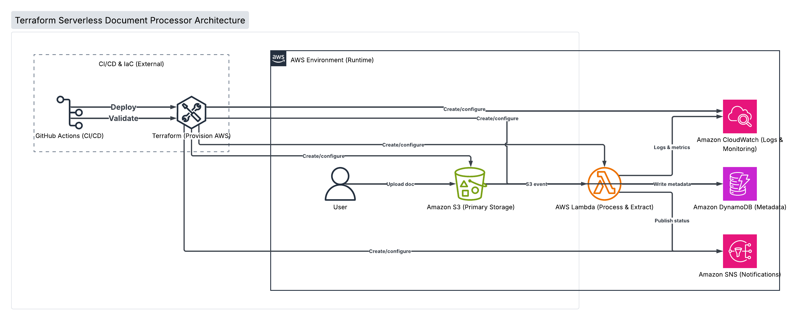

# Terraform Serverless Document Processor

## Introduction

The **Terraform Serverless Document Processor** is a cloud engineering portfolio project designed to demonstrate modern infrastructure and deployment practices using **Infrastructure as Code (IaC)**, **serverless AWS architecture**, and **CI/CD automation**.

The goal of this project is to build a scalable document processing workflow where files uploaded by users are automatically processed through an event-driven AWS architecture. Instead of manually configuring cloud resources, Terraform is used to provision and manage all infrastructure components.

When a document is uploaded to Amazon S3, an event triggers an AWS Lambda function that processes the file, stores document metadata in DynamoDB, and publishes completion notifications through Amazon SNS. A GitHub Actions pipeline automates infrastructure validation and deployment to create a repeatable software delivery workflow.

This project demonstrates practical experience with cloud infrastructure management, automation, security principles, and DevOps workflows.

---

# Table of Contents

* [Project Overview](#project-overview)
* [Features](#features)
* [Architecture](#architecture)
* [Technologies](#technologies)
* [Infrastructure Design](#infrastructure-design)
* [CI/CD Pipeline](#cicd-pipeline)
* [Project Development Timeline](#project-development-timeline)
* [Installation and Configuration](#installation-and-configuration)
* [Future Improvements](#future-improvements)
* [Lessons Learned](#lessons-learned)

---

# Project Overview

The application implements a serverless document processing pipeline using AWS managed services.

The system allows users to upload documents into an Amazon S3 bucket. Once a document is uploaded:

1. Amazon S3 generates an event notification.
2. AWS Lambda processes the uploaded document.
3. Document metadata is stored in DynamoDB.
4. Amazon SNS sends a notification confirming processing completion.
5. CloudWatch collects logs for monitoring and debugging.

Terraform manages the creation and configuration of all AWS resources.

---

# Features

## Infrastructure as Code

* Automated AWS resource provisioning using Terraform
* Reproducible cloud infrastructure
* Terraform state management
* Infrastructure validation before deployment

## Serverless Architecture

* Event-driven document processing workflow
* No server management required
* Automatic scaling through AWS managed services

## Document Processing

* Upload documents through Amazon S3
* Trigger automated processing through Lambda
* Store document metadata in DynamoDB

## Notifications

* Publish processing status updates through Amazon SNS
* Enable event-based communication between services

## CI/CD Automation

* Automated Terraform formatting checks
* Terraform validation
* Infrastructure deployment workflow through GitHub Actions

---

# Architecture



The architecture diagram combines both the infrastructure deployment workflow and the AWS serverless application workflow. The deployment pipeline begins with source code changes pushed to GitHub, which triggers a GitHub Actions CI/CD workflow. The pipeline validates Terraform configurations and applies infrastructure changes to provision AWS resources.

Once deployed, the serverless application workflow begins when a user uploads a document to Amazon S3. The S3 event notification invokes an AWS Lambda function that processes the uploaded document. Lambda then interacts with downstream AWS services by storing document metadata in DynamoDB, publishing processing notifications through SNS, and generating logs and metrics in CloudWatch for monitoring and troubleshooting.

---

# Technologies

## Cloud Services

* AWS Lambda
* Amazon S3
* Amazon DynamoDB
* Amazon SNS
* AWS IAM
* Amazon CloudWatch

## Infrastructure

* Terraform

## Programming

* Python

## DevOps

* GitHub Actions
* CI/CD Pipelines
* Automated Deployment

---

# Infrastructure Design

Terraform provisions the following AWS resources:

| Resource   | Purpose                         |
| ---------- | ------------------------------- |
| Amazon S3  | Stores uploaded documents       |
| AWS Lambda | Processes uploaded files        |
| DynamoDB   | Stores document metadata        |
| SNS        | Sends processing notifications  |
| IAM        | Controls resource permissions   |
| CloudWatch | Provides logging and monitoring |

Security considerations include:

* Least-privilege IAM permissions
* S3 bucket encryption
* Secure resource configuration
* Environment variable management

---

# CI/CD Pipeline

The project uses GitHub Actions to automate infrastructure validation and deployment.

Pipeline workflow:

```
Code Commit
      |
      v
GitHub Actions Trigger
      |
      v
Terraform Format Check
      |
      v
Terraform Validation
      |
      v
Terraform Plan
      |
      v
Infrastructure Deployment
```

The pipeline ensures infrastructure changes are reviewed and validated before deployment.

---

# Project Development Timeline

The project is developed incrementally to demonstrate infrastructure evolution.

## Commit 1: Create S3 Bucket

* Initialize Terraform project
* Configure AWS provider
* Create S3 storage resource

## Commit 2: Enable Versioning

* Add S3 version control
* Protect against accidental file overwrites

## Commit 3: Add Bucket Encryption

* Enable server-side encryption
* Improve data protection

## Commit 4: Create Lambda Function

* Develop Python Lambda handler
* Configure Lambda deployment package

## Commit 5: Connect S3 to Lambda

* Configure S3 event triggers
* Automate document processing workflow

## Commit 6: Create DynamoDB Table

* Store document metadata
* Implement database integration

## Commit 7: Add SNS Notifications

* Publish processing completion messages
* Add event-driven communication

## Commit 8: Add GitHub Actions CI/CD

* Automate Terraform validation
* Automate deployment workflow

---

# Installation and Configuration

## Prerequisites

* AWS Account
* Terraform installed
* AWS CLI installed
* GitHub Account

## Clone Repository

```bash
git clone <https://github.com/selenasat/terraform-serverless-document-processor.git>

cd terraform-serverless-document-processor
```

## Configure AWS Credentials

Configure AWS CLI credentials:

```bash
aws configure
```

## Initialize Terraform

```bash
terraform init
```

## Validate Configuration

```bash
terraform validate
```

## Preview Infrastructure Changes

```bash
terraform plan
```

## Deploy Infrastructure

```bash
terraform apply
```

---

# Future Improvements

Potential enhancements:

* Add automated unit testing for Lambda
* Add Terraform remote state storage using S3
* Add DynamoDB encryption
* Add API Gateway for document upload
* Add authentication using Amazon Cognito
* Add monitoring dashboards with CloudWatch
* Add Docker-based local development environment

---

# Lessons Learned

This project provides hands-on experience with:

* Designing serverless cloud architectures
* Managing infrastructure through Terraform
* Implementing CI/CD workflows
* Applying cloud security best practices
* Building scalable event-driven applications

The project demonstrates how modern software teams combine application development, cloud infrastructure, and automation to create reliable production systems.
